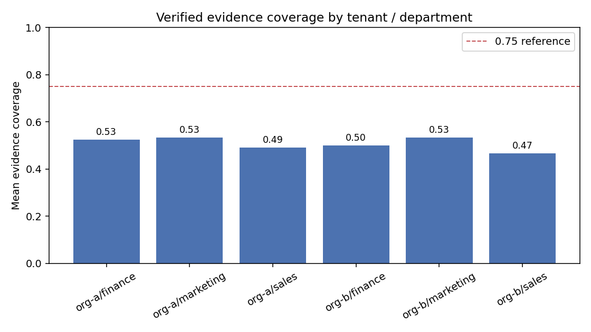

# بخش ۵ — آماده‌سازی داده و مهندسی context

۸ نمره · ۱۲ زیرسؤال · داده‌های `01_HR`، `02_Context`، `03_Requests`

> همهٔ اعداد این بخش از اجرای واقعی `work/sec05_data/run_section5.py` آمده‌اند.
> خروجی خام: [`Day4_Run_Output/section5.json`](../Day4_Run_Output/section5.json)
> نمودار: [`Day4_Run_Output/coverage_by_department.png`](../Day4_Run_Output/coverage_by_department.png)

## اجرا

```cmd
.venv\Scripts\python.exe work\sec05_data\run_section5.py
.venv\Scripts\python.exe work\sec05_data\apply_section5.py
.venv\Scripts\python.exe work\sec05_data\summary.py
```

کد در [`work/sec05_data/context_ops.py`](../work/sec05_data/context_ops.py) است؛ هر تابع یک زیرسؤال.

## خلاصهٔ نتایج

| سؤال | یافتهٔ کلیدی                                         |
| ---- | ---------------------------------------------------- |
| ۵٫۱  | ۱۸۰ فرد · ۶ سیاست · ۹۶ سند · splitهای ۲۰۰/۸۰/۸۰      |
| ۵٫۲  | ۱۶ سند مجاز از ۹۶ (۴۸ tenant دیگر، ۳۲ دپارتمان دیگر) |
| ۵٫۳  | ۶ بخش جا شد، ۹۰۰ از ۱۰۰۰ واحد مصرف، ۱۰۰ باقی         |
| ۵٫۴  | بودجهٔ ناکافی صریح رد شد (نیاز ۵۲۰، ظرفیت ۴۰۰)       |
| ۵٫۵  | ۴ سند بازیابی شد، `limit=0` رد شد                    |
| ۵٫۶  | ایمیل حذف و متن کاری حفظ شد                          |
| ۵٫۷  | ۱۶ → ۴ سند، ۷۵٪ کاهش کاراکتر                         |
| ۵٫۸  | ۵ ارجاع، ۵۱٫۷٪ کاهش حجم JSON                         |
| ۵٫۹  | context سیاست ۵ فیلد، متخصص شواهد فقط‌خواندنی        |
| ۵٫۱۰ | ۳ ادعای مستند، `decision=skills_inventory_only`      |
| ۵٫۱۱ | نقل قول دستکاری و ارجاع جعلی هر دو رد شدند           |
| ۵٫۱۲ | میانگین پوشش ۵۰٫۸۳٪، دامنه ۰٫۴۶۷ تا ۰٫۵۳۳            |

**۱۵ کنترل خودکار، همه قبول:** یکتایی شناسه‌ها، جدایی splitها، نشت‌نداشتن scope، جا شدن بودجه، رد بودجهٔ ناکافی، رد `limit=0`، حذف ایمیل، حفظ متن کاری، کاهش حذف تکرار، کاهش فشرده‌سازی، کمینه بودن context سیاست، فقط‌خواندنی بودن متخصص شواهد، رد دستکاری نقل قول، رد ارجاع جعلی، معتبر بودن پروفایل پایه.

---

## ۵٫۱ — بارگذاری و اعتبارسنجی

**روش:** چهار فایل را بارگذاری کردم، رکوردها را شمردم، یکتایی شناسه‌ها را بررسی کردم و برای جدایی splitها الگوی «variant N» را از انتهای متن حذف و متن باقی‌مانده را بین جفت‌های split مقایسه کردم.

| قلم           | مقدار                         |
| ------------- | ----------------------------- |
| افراد         | ۱۸۰                           |
| سیاست‌ها      | ۶ (۶ ترکیب tenant×department) |
| اسناد         | ۹۶                            |
| درخواست‌ها    | ۳۶۰                           |
| split         | train=۲۰۰ · dev=۸۰ · test=۸۰  |
| خانوادهٔ قالب | train=۱۰ · dev=۴ · test=۴     |

**یکتایی:** `employee_id`=۱۸۰/۱۸۰ · `doc_id`=۹۶/۹۶ · `request_id`=۳۶۰/۳۶۰ · ترکیب سیاست=۶/۶.

**جدایی splitها:** هم‌پوشانی خانوادهٔ قالب و متن در هر سه جفت `train~dev`، `train~test`، `dev~test` **صفر** است.

**تحلیل:** هر split خانواده‌های انحصاری دارد و پس از حذف شمارهٔ نمایشی هیچ متن مشترکی بین splitها نیست. پس مدل مسیریابی باید روی معنا تعمیم دهد، نه روی خانوادهٔ قالب یا شناسه.

**محدودیت:** این شمارش صحت ساختار داده را نشان می‌دهد، نه کیفیت برچسب‌ها. برچسب `test` در بسته نیست.

## ۵٫۲ — فیلتر scope پیش از بازیابی

**روش:** principal معتبر برای `org-a/finance` ساختم و فیلتر را **پیش از** هر امتیازدهی اعمال کردم.

| قلم                                   | تعداد |
| ------------------------------------- | ----- |
| اسناد مجاز                            | ۱۶    |
| حذف به دلیل tenant دیگر               | ۴۸    |
| حذف به دلیل دپارتمان دیگر همان tenant | ۳۲    |
| جمع                                   | ۹۶ ✅ |

**تحلیل:** چون فیلتر قبل از بازیابی اجرا می‌شود، اسناد غیرمجاز هرگز کاندید نمی‌شوند. این تفاوت «کنترل» با «امید» است: اگر فیلتر بعد از بازیابی اعمال شود، مدل ممکن است محتوای غیرمجاز را دیده باشد.

**محدودیت:** principal از برنامه می‌آید و fixture است؛ احراز هویت واقعی اجرا نشده.

## ۵٫۳ — تخصیص بودجه با پنجرهٔ ۱۲۰۰

**روش:** ابتدا ذخیرهٔ پاسخ (۲۰۰) را از پنجره (۱۲۰۰) کم کردم تا ظرفیت ورودی **۱۰۰۰** شود، سپس mandatory را چیدم و بعد optional را به ترتیب اولویت نزولی.

| بخش      | توکن | اولویت | وضعیت        |
| -------- | ---- | ------ | ------------ |
| system   | ۱۲۰  | ۱۰۰    | ✅ mandatory |
| task     | ۸۰   | ۱۰۰    | ✅ mandatory |
| tools    | ۱۴۰  | ۹۰     | ✅ mandatory |
| policy   | ۱۸۰  | ۸۰     | ✅ mandatory |
| evidence | ۲۲۰  | ۷۰     | ✅ optional  |
| memory   | ۱۶۰  | ۴۰     | ✅ optional  |
| history  | ۳۵۰  | ۱۵     | ❌ جا نشد    |
| noise    | ۵۰۰  | ۱      | ❌ جا نشد    |

**مصرف:** ۹۰۰ از ۱۰۰۰ · **باقی‌مانده:** ۱۰۰ · **بهره‌وری:** ۹۰٪

**تحلیل:** کم‌کردن ذخیرهٔ پاسخ **قبل** از تخصیص، از سرریز پنجره هنگام تولید جلوگیری می‌کند. باقی‌ماندهٔ ۱۰۰ واحد از ۱۶۰ واحد `memory` کمتر است، پس حتی با اولویت بالاتر هم `history` جا نمی‌شد؛ ترتیب اولویت در این پنجره حساس نیست اما در پنجره‌های تنگ‌تر تعیین‌کننده می‌شود.

**محدودیت:** `estimated_tokens` برآورد آموزشی است و شمارش tokenizer واقعی نیست.

## ۵٫۴ — کنترل بودجهٔ ناکافی

**روش:** همان تابع با پنجرهٔ ۶۰۰ و ذخیرهٔ ۲۰۰.

**خروجی:** ظرفیت ۴۰۰ واحد، نیاز mandatory ۵۲۰ واحد → `BudgetError` با متن صریح:

```
mandatory parts need 520 tokens but only 400 are available (window=600, reserve=200)
```

**تحلیل:** کنترل درست، شکست صریح است نه کوتاه‌کردن بی‌صدا. اگر بودجهٔ ناکافی پنهان بماند، agent با context ناقص ادامه می‌دهد و خطای بعدی غیرقابل ردیابی می‌شود.

## ۵٫۵ — بازیابی TF-IDF

**روش:** روی ۱۶ سند مجاز یک بردارساز TF-IDF ساختم و پرس‌وجوی `reconciliation evidence` را با شباهت کسینوسی امتیاز دادم. `limit` پیش از هر کار اعتبارسنجی شد.

| رتبه | شناسه                | نوع     | score    |
| ---- | -------------------- | ------- | -------- |
| ۱    | `X-9624341957bb71ab` | example | ۰٫۵۹۹۲۸۸ |
| ۲    | `X-d85283b0ac9391e3` | example | ۰٫۵۹۹۲۸۸ |
| ۳    | `X-f93fdea50e1651c6` | example | ۰٫۵۹۹۲۸۸ |
| ۴    | `X-a1b94e8f335f39e0` | policy  | ۰٫۵۴۶۷۱۵ |

**`limit=0`:** با `ValueError` رد شد.

**تحلیل:** امتیاز سه سند یکسان است چون متن canonical آن‌ها یکی است — همان تکراری که در ۵٫۷ حذف می‌شود. رتبه‌بندی بدون فیلتر scope، اسناد `org-b` را هم وارد می‌کرد.

**محدودیت:** TF-IDF بر تطابق واژه تکیه دارد و هم‌معنا را نمی‌فهمد.

## ۵٫۶ — حذف ایمیل پیش از لاگ

**روش:** regex محافظه‌کار برای ایمیل، سپس بررسی حفظ واژه‌های کاری.

| سنجه            | مقدار                      |
| --------------- | -------------------------- |
| ایمیل یافت‌شده  | `ali.reza@example.invalid` |
| ایمیل حذف شد    | بله                        |
| متن کاری حفظ شد | بله                        |
| طول متن         | ۱۵۰ → ۱۴۲ کاراکتر          |

**تحلیل:** redaction پیش از لاگ نشت PII را می‌بندد بدون نابودکردن معنا.

**محدودیت regex:** الگو این حالت‌ها را نمی‌گیرد:

- دامنهٔ بدون نقطه
- ایمیل مبهم‌سازی‌شده: «ali dot reza at example dot invalid»
- آدرس داخل تصویر
- ایمیل با فاصله یا کاراکتر یونیکد مشابه

پس regex یک لایه است نه تضمین؛ برای PII واقعی به تشخیص‌گر اختصاصی یا سرویس redaction نیاز است.

## ۵٫۷ — حذف تکرار بر مبنای متن canonical

**روش:** متن هر سند را canonical کردم (lowercase، یکسان‌سازی فاصله، حذف نقطهٔ انتهایی) و اولین رخداد هر متن را نگه داشتم.

| سنجه       | مقدار              |
| ---------- | ------------------ |
| پیش از حذف | ۱۶ سند             |
| پس از حذف  | ۴ سند              |
| حذف‌شده    | ۱۲ سند             |
| حجم متن    | ۲۹۳۶ → ۷۳۴ کاراکتر |
| کاهش       | **۷۵٪**            |

**تحلیل:** چهار متن باقی‌مانده چهار مهارت سیاست `finance` را پوشش می‌دهند (reconciliation، forecasting، reporting، compliance)، پس حذف تکرار اطلاعاتی را از دست نداد. این بزرگ‌ترین صرفه‌جویی بخش ۵ است.

**محدودیت:** canonical‌سازی فقط تفاوت سطحی را می‌گیرد؛ دو متن هم‌معنا با واژهٔ متفاوت تکراری شمرده نمی‌شوند.

## ۵٫۸ — فشرده‌سازی evidence به ارجاع

**روش:** هر آیتم به سه‌گانهٔ `evidence_id`/`skill`/`verified` کاهش یافت و متن کامل بیرون context ماند.

| سنجه              | مقدار             |
| ----------------- | ----------------- |
| ارجاع‌های حفظ‌شده | ۵                 |
| حجم JSON          | ۸۴۱ → ۴۰۶ کاراکتر |
| کاهش              | **۵۱٫۷٪**         |

**تحلیل:** ارجاع هویت شاهد را نگه می‌دارد ولی متن را از پنجره بیرون می‌برد. این با `Isolate` فرق دارد: اینجا هدف کاهش حجم است، نه جداسازی context.

**محدودیت:** کاهش کاراکتر، کاهش توکن واقعی نیست چون tokenizer اجرا نشده.

## ۵٫۹ — context کمینهٔ متخصص‌ها

**روش:** دو context با ساختار متفاوت و سطح ابزار جداگانه.

| سنجه        | متخصص سیاست | متخصص شواهد |
| ----------- | ----------- | ----------- |
| فیلدها      | ۵           | ۸۶ ارجاع    |
| حجم         | ۱۷۶ بایت    | ۷۰۵۱ بایت   |
| ایمیل دارد؟ | خیر         | خیر         |
| رزومه دارد؟ | خیر         | خیر         |
| ابزار نوشتن | ندارد       | ندارد       |

**تحلیل:** کمینه‌سازی هزینهٔ توکن و سطح حمله را با هم کم می‌کند: متخصص سیاست داده‌ای برای نشت ندارد و متخصص شواهد نمی‌تواند حافظه را آلوده کند.

**محدودیت:** تفکیک در سطح کد است؛ اگر هر دو متخصص یک principal مشترک داشته باشند، جداسازی دور زده می‌شود.

## ۵٫۱۰ — پروفایل مستند

**روش:** برای `X-83c9e5db8f89697f` فقط شواهد `verified=true` با مهارت داخل سیاست دپارتمان پذیرفته شد.

```json
{
  "employee_id": "X-83c9e5db8f89697f",
  "claims": 3,
  "covered_skills": ["compliance", "forecasting", "reporting"],
  "missing_skills": ["reconciliation"],
  "decision": "skills_inventory_only"
}
```

**تحلیل:** پذیرش فقط شاهد تأییدشده جلوی تکیه بر خودگزارشی را می‌گیرد. نبود `reconciliation` یک یافتهٔ واقعی است، نه نقص کد؛ پروفایل باید کمبود را نشان دهد نه پنهان کند.

**محدودیت:** این فهرست مهارت مستند است و هیچ رتبه‌بندی استخدامی، حقوقی یا ارتقایی تولید نمی‌کند.

## ۵٫۱۱ — آزمون دستکاری

**روش:** پروفایل معتبر را دو بار دستکاری کردم و از نو با داده بازسازی و مقایسه کردم.

| حالت                | نتیجه | کد خطا             |
| ------------------- | ----- | ------------------ |
| نقل قول دستکاری‌شده | رد شد | `quote_mismatch`   |
| `evidence_id` جعلی  | رد شد | `unknown_evidence` |
| پروفایل پایه        | معتبر | ۳ ادعا تأیید شد    |

**تحلیل:** اعتبارسنجی ادعا را از داده بازسازی می‌کند نه اینکه به شکل JSON اعتماد کند؛ به همین دلیل تغییر یک‌کاراکتری هم گرفته می‌شود.

**محدودیت:** این آزمون دستکاری سطح فیلد را می‌گیرد. اگر مهاجم هم نقل قول و هم `evidence_id` را با یک رکورد واقعی دیگر عوض کند، اعتبارسنجی فیلدی رد نمی‌کند و به کنترل scope و مالکیت شاهد نیاز است.

## ۵٫۱۲ — پوشش شواهد

**روش:** برای هر ۱۸۰ فرد نسبت مهارت‌های دارای شاهد تأییدشده به چهار مهارت سیاست دپارتمان خودش، سپس میانگین به تفکیک `tenant×department`.

| دپارتمان        | کارکنان | میانگین   | کمینه | بیشینه |
| --------------- | ------- | --------- | ----- | ------ |
| org-a/finance   | ۳۰      | ۰٫۵۲۵     | ۰٫۲۵  | ۰٫۷۵   |
| org-a/marketing | ۳۰      | ۰٫۵۳۳     | ۰٫۲۵  | ۰٫۷۵   |
| org-a/sales     | ۳۰      | ۰٫۴۹۲     | ۰٫۲۵  | ۰٫۷۵   |
| org-b/finance   | ۳۰      | ۰٫۵۰۰     | ۰٫۲۵  | ۰٫۷۵   |
| org-b/marketing | ۳۰      | ۰٫۵۳۳     | ۰٫۲۵  | ۰٫۷۵   |
| org-b/sales     | ۳۰      | ۰٫۴۶۷     | ۰٫۲۵  | ۰٫۷۵   |
| **کل**          | **۱۸۰** | **۰٫۵۰۸** | ۰٫۲۵  | ۰٫۷۵   |



**تحلیل:** اختلاف بین دپارتمان‌ها کوچک است (۰٫۴۶۷ تا ۰٫۵۳۳)، یعنی کمبود شاهد الگوی سازمانی دارد نه فردی. هیچ دپارتمانی به پوشش کامل نزدیک نیست و همه زیر خط مرجع ۰٫۷۵ هستند.

**چرا نمرهٔ استخدام نیست:** این نسبت فقط می‌گوید چه سهمی از مهارت‌های الزامی شاهد تأییدشده دارند. شاهد، وقوع کار را نشان می‌دهد نه کیفیت آن؛ فرد بدون شاهد لزوماً کم‌مهارت نیست، ممکن است مستندسازی نشده باشد. استفاده از این عدد برای استخدام یا ارتقا خارج از دامنهٔ تمرین و ناقض `skills_inventory_only` است.

**محدودیت:** داده مصنوعی است؛ این توزیع ویژگی دادهٔ آموزشی است نه یافته‌ای دربارهٔ افراد واقعی.

---

## مرز اجرا

| مؤلفه                        | وضعیت                      |
| ---------------------------- | -------------------------- |
| بارگذاری و شمارش داده        | واقعی                      |
| فیلتر scope                  | واقعی                      |
| تخصیص بودجه                  | واقعی (برآورد توکن آموزشی) |
| TF-IDF و شباهت کسینوسی       | واقعی (`scikit-learn`)     |
| حذف تکرار و فشرده‌سازی       | واقعی                      |
| اعتبارسنجی پروفایل           | واقعی                      |
| نمودار                       | واقعی (`matplotlib`)       |
| توکنایزر واقعی مدل           | **اجرا نشده**              |
| LLM زنده                     | **اجرا نشده**              |
| principal واقعی و احراز هویت | **fixture**                |
